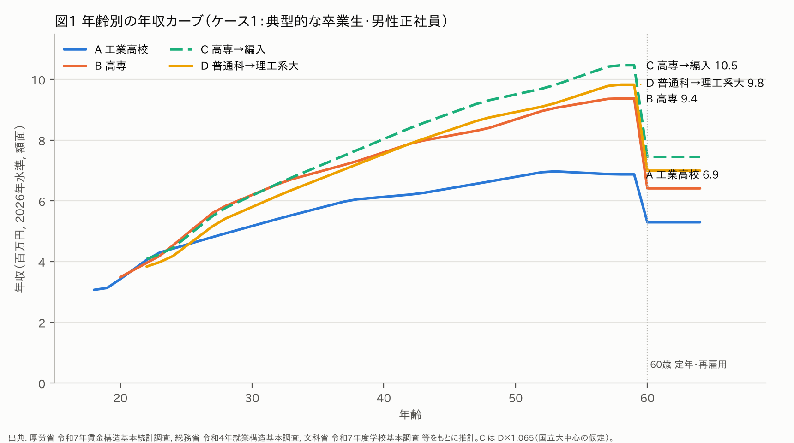
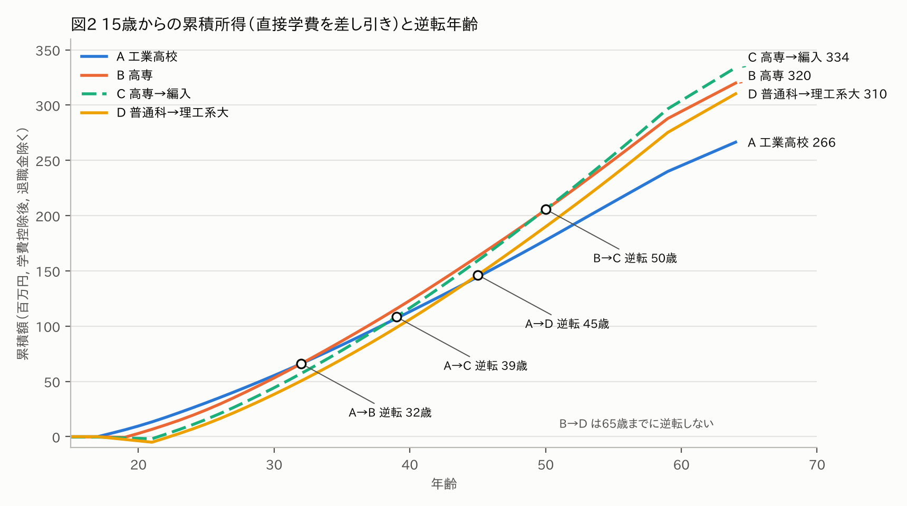
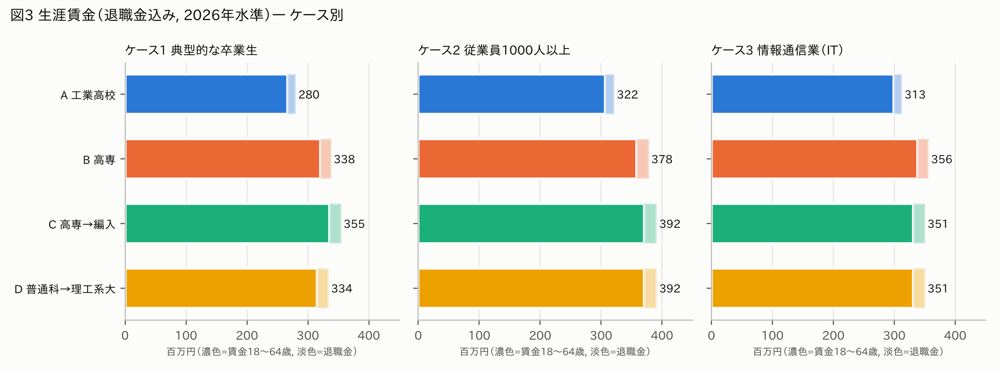
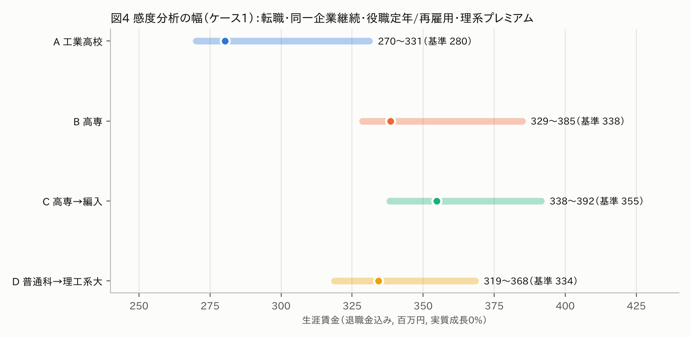

# 工業高校・高専・高専→大学編入・普通科→理系大学の生涯年収比較

**日本・男性・工学系・2026年賃金水準**　（調査日：2026年11月13日）

> **前提**：2026年に15歳（中3）の男子が、各ルートを経て標準年齢で正社員として就職し、**65歳到達まで（64歳末まで）**働くと仮定。金額は**2026年の名目賃金水準**（将来の実質賃金成長0％を基準とし、成長は感度分析で別扱い）。全国平均・男性・工学系。「生涯年収」は額面の給与＋賞与（退職金は別掲）。
> 本文では、公的統計の値をそのまま使った部分を **【統計】**、モデルや仮定による推計を **【推計】** と表示しています。再現用のコードは [`model/`](model/)（`run_all.sh` で公的統計のダウンロードからこの文書の数値・図までを再生成）にあります。

## 一覧：4ルートの比較（ケース1＝全国の典型的な卒業生）

| 進路 | 就職開始年齢 | 生涯年収 平均 （賃金のみ、〜64歳） | 生涯年収 中央値 （推計値） | 退職金込み生涯賃金 （平均） | 推計の確からしさ |
|---|---|---|---|---|---|
| A 工業高校卒 | 18歳 | **2.66億円** | 2.52億円 | **2.80億円** | ★★★☆ 中〜高（高卒の公的統計に直接依拠。工業科の特徴は産業構成でのみ補正） |
| B 高専卒 | 20歳 | **3.20億円**（推計幅 3.13〜3.28） | 3.08億円 | **3.38億円** | ★★☆☆ 中（公的統計に「高専のみ」の賃金表がなく、2つの方法で推計） |
| C 高専＋大学編入卒 | 22歳 | **3.36億円**（推計幅 3.15〜3.63） | 3.09億円 | **3.55億円** | ★☆☆☆〜★★☆☆ 低〜中（直接の統計が存在しない。編入先大学の賃金プレミアム仮定に依存） |
| D 普通科＋理系大学卒 | 22歳 | **3.15億円** | 2.90億円 | **3.34億円** | ★★★☆ 中〜高（大卒の公的統計に依拠。工学部固有の上乗せは不確実） |

- 中央値は**統計から直接は得られないため推計値**です（年齢別の「中央値÷平均」比〔就業構造基本調査〕を平均の年収カーブに掛けて合計）。年齢別中央値の合計は「生涯年収の分布の中央値」と同じではありません（後述）。**平均値を中央値として扱っていません。**
- 手取り概算（退職金込み）：A 2.18億円、B 2.56億円、C 2.65億円、D 2.52億円（単身・扶養なしの2026年税制で計算）。
- 雇用リスク込みの期待値（非正規化・無業の確率を織り込み、退職金は7割で評価）：A 2.29億円、B 2.97億円、C 3.21億円、D 3.03億円【推計】。

---

## 1. 結論：最も生涯年収が高いルートと金額差

**平均的な卒業生の生涯年収（退職金込み、2026年水準）は C（3.55億）＞ B（3.38億）≒ D（3.34億）≫ A（2.80億）。** 【推計】

| 比較 | 金額差（退職金込み） | 割合差 |
|---|---|---|
| C − A | +0.74億円 | +27％ |
| B − A | +0.58億円 | +21％ |
| D − A | +0.54億円 | +19％ |
| C − B（編入の効果） | +0.16億円 | +4.8％ |
| C − D | +0.21億円 | +6.1％ |
| B − D | +0.04億円 | +1.3％ |

読み方として重要な点が4つあります。

1. **A（工業高校）が最も低いという結論は頑健です。** 感度分析のどの条件でもAは最下位でした。大企業に就職し同じ会社に定年まで勤める場合でも3.2〜3.3億円で、平均的なDとほぼ同水準にとどまります。
2. **BとDの差（+1.3％）は推計誤差の範囲内で、実質的には同等です。** Bは2年早く働き始める分だけ累積で有利です。一方、50代の年収はDの方が高く、工学系大卒の賃金がこの推計より約3％以上高ければ順位は入れ替わります。
3. **Cは平均では最も高いものの、その上乗せは「編入先が国立大中心である」という仮定に依存します。** 編入しても平均的な工学部卒と同じ賃金にしかならない場合、CはBより約0.04億円低くなります。
4. **将来の所得を割り引くと、早く働き始めるルートが有利になります。** 2％で現在価値に割り引くと B（1.92億）≒ C（1.96億）＞ D（1.81億）＞ A（1.64億）でした。BとCは事実上同額で、Dは両者を明確に下回ります。

**最終的な問いへの答え**（詳細は第5〜7章）：
**平均的な卒業生が「再現性高く」到達しやすいのは高専（B）系統です。** B単独でも平均的なDと同等の生涯年収を2年早い就業開始で実現し、学費負担はDの1/10程度、正社員比率・大企業比率も高くなっています。高専から国立大へ編入（C）すれば期待値はさらに約5％上がりますが、上乗せの大きさは編入先次第で、確実性は下がります。Dが同等以上になるのは、地方国公立以上の大学に進む場合（＝高専に合格できる学力層とほぼ同じ層）です。Aは、学力が同程度でも生涯年収が約15〜20％低くなる見込みです。

---

## 2. 4ルートの年齢別年収曲線

**表2-1 年代別の平均年収（百万円、額面、2026年水準）** 【推計】

| 進路 | 18〜19歳 | 20代 | 30代 | 40代 | 50代 | 60〜64歳 |
|---|---|---|---|---|---|---|
| A 工業高校 | 3.10 | 4.40 | 5.68 | 6.40 | 6.90 | 5.30 |
| B 高専 | – | 4.75（20〜29歳） | 6.87 | 8.09 | 9.13 | 6.42 |
| C 高専→編入 | – | 5.00（22〜29歳） | 7.04 | 8.78 | 10.04 | 7.45 |
| D 普通科→理工系大 | – | 4.70（22〜29歳） | 6.61 | 8.24 | 9.42 | 7.00 |

**表2-2 年代別の中央値年収（推計、百万円）**：A 4.25 / 5.46 / 6.04 / 6.52 / 4.75、B 4.62 / 6.72 / 7.68 / 8.92 / 5.72、C 4.72 / 6.49 / 8.17 / 9.52 / 5.84、D 4.43 / 6.10 / 7.67 / 8.94 / 5.48（20代/30代/40代/50代/60〜64歳）。

**カーブの特徴**
- **A**：20代前半はBと並ぶものの、30代以降の伸びが小さく、50代のピークは約690万円です（大卒の約7割）。技能職中心で年功カーブが平坦なことと、管理職への登用率が低いこと（第4章）が理由です。
- **B**：30代〜40代前半では平均的なDを上回ります（高専卒が大企業に多く、実務経験も2年長いため）。40代後半以降はDの伸びに追い抜かれます。
- **C／D**：50代の伸びが最も大きく、60歳以降の再雇用期の水準も高くなっています。

**統計上の根拠と推計方法**
- 【統計】厚生労働省「令和7年賃金構造基本統計調査」（2025年6月分の月例賃金と、2024年の年間賞与）。男性・**正社員・正職員のうち雇用期間の定め無し**・企業規模10人以上・学歴×5歳階級。年収＝きまって支給する現金給与額×12＋年間賞与。60〜64歳は再雇用（有期の嘱託など）を含めるため「一般労働者計」を使用しました。
- 【推計】2026年水準への換算：月例賃金は＋3.0％（2026年春闘の連合最終集計は定昇込み5.01％、賃上げ分が明確な組合のベースアップ相当は3.50％。中小・非組合企業を考慮してやや控えめに設定）、賞与は2年分で＋6.2％、初任給は＋3.5％。
- 【推計】1年目の年収＝2025年の初任給（男性：高卒210.1千円、高専・短大卒241.4千円、大卒264.9千円）×1.035×（時間外を含め1.08）×12＋賞与1か月分。2年目以降は階級の平均年齢を節点に直線補間しました。
- 【推計】A：高卒全体のカーブに、**工業科男子就職者の産業構成**（製造53.6％、建設18.3％など）で重みを付けた産業別カーブとの比（＋1〜6％）を掛けました。
- 【推計】D：大卒全体のカーブに、**工学部（学部）男子就職者の産業構成**で同様の補正をしました。補正率はほぼ±1％で、工学部卒の産業構成は大卒平均と大差ありません。
- 【推計】B：後述の2方法の平均です。C：D×1.065（第5章）。

---

## 3. 年齢別の累積所得と逆転年齢

**表3-1 累積所得の逆転年齢（後発ルートの累積が先発ルートを恒久的に上回る年齢）** 【推計】

| 比較 | ケース1 額面 | ケース1 学費控除後 | ＋下宿費 | ケース2（大企業） | ケース3（IT） |
|---|---|---|---|---|---|
| A→B（高専が工業高校に追いつく） | 32歳 | 32歳 | 32歳 | 37歳 | 29歳 |
| A→C | 38歳 | 39歳 | 40歳 | 42歳 | 43歳 |
| A→D | 42歳 | 45歳 | 45歳 | 43歳 | 45歳 |
| B→C（編入が元を取る） | 48歳 | 50歳 | 52歳 | 53歳 | 逆転せず |
| B→D | 逆転せず | 逆転せず | 逆転せず | 56歳 | 逆転せず |

- **Aの2年先行の優位は30代前半まで続きます。** 18歳から2年間で約620万円を先に稼ぎますが、Bは24歳頃には年収でAを上回り、32歳で累積でも追いつきます。
- Dは学費（私大理工系中心で約500万円）と4年間の就業の遅れがあるため、**累積でAを抜くのは42〜45歳**です。
- 割引率を2〜3％とすると、AがDに並ぶにはAの賃金が+7〜11％上がるだけで足ります（割引なしでは+18％必要）。**早期の所得を重視する家計ほどA・Bが相対的に有利**になります。

---

## 4. 就職先・職種・昇進機会の比較

### 4-1 卒業時の進路（新規学卒、【統計】文部科学省「令和7年度学校基本調査」、2025年3月卒）

| | 工業高校（工業科） | 高専（本科） | 大学・工学部 |
|---|---|---|---|
| 卒業者数 | 63,695人（男女計） | 9,756人（男7,587人） | 87,287人（男73,211人） |
| 就職 | 63.3％ | 男56.0％（無期雇用） | 男53.7％（無期雇用） |
| 進学 | 大学・短大等18.2％、専修学校等16.6％ | 男40.8％（大学編入・専攻科） | 男41.0％（**国立72.3％**、公立45.8％、私立24.3％） |

学部卒で就職する工学部男子のうち**約80％は私立大学の卒業生**です（国立14％、公立5％。設置者別の就職率から算出）。国立の工学部は7割以上が大学院に進むためです。これが「典型的なD」の姿です。

### 4-2 業界（男子就職者の産業構成、【統計】同上）

| 産業 | 工業科 | 高専 | 工学部（学部） |
|---|---|---|---|
| 製造業 | **53.6％** | **46.2％** | 25.9％ |
| 建設業 | 18.3％ | 9.5％ | 16.8％ |
| 情報通信業 | 1.0％ | 15.1％ | **22.6％** |
| 電気・ガス・水道（インフラ） | 3.5％ | 8.0％ | 1.4％ |
| 運輸・郵便 | 4.8％ | 6.9％ | 2.3％ |
| 学術研究・専門技術サービス | 2.7％ | 4.7％ | 5.8％ |
| サービス業（技術者派遣等を含む） | 4.6％ | 3.3％ | 9.1％ |
| 公務 | 4.0％ | 2.2％ | 4.5％ |

### 4-3 職種

- **工業科**【統計】：生産工程従事者54.6％（製造・加工30.9％、機械組立13.5％、整備・修理6.5％）、専門的・技術的職業17.6％、建設・採掘12.9％。**技能職・生産職・保全職が中心**です。
- **高専**【統計】：専門的・技術的職業が91.7％。内訳は製造技術者（開発）20.9％、製造技術者（開発以外＝生産技術・品質・保全など）32.6％、情報処理・通信技術者17.6％、建築・土木・測量技術者11.6％。**設計・生産技術・保全・SEなどの技術職が中心**です。ただし就業構造基本調査で本人が回答した現職では、25〜34歳男性正規の高専卒のうち専門・技術職31.5％、生産工程29.7％、事務14.5％でした。学校側の分類より現場寄りの職務に就く人も相当数いると読めます。
- **大卒（全専攻）**【統計】（就業構造、25〜34歳男性正規）：専門・技術職31.0％、事務24.0％、販売19.3％、生産工程8.5％。工学部卒に限ると技術職の比率はさらに高いと考えられます（専攻別の公的統計はありません）。
- **研究開発職**は、新卒段階では少数です（2025年3月の高専卒就職者のうち、学校基本調査の職業分類で「研究者」は0人）。研究職は主に大学院修了者の職域です。

### 4-4 企業規模（【統計】総務省「令和4年就業構造基本調査」第16表、男性・正規の職員・従業員、25〜34歳）

| | 1000人以上 | 100〜999人 | 99人以下 | 官公庁 |
|---|---|---|---|---|
| 高校卒 | 26.5％ | 26.0％ | 36.3％ | 6.0％ |
| **高専卒** | **46.3％** | 28.8％ | 16.9％ | 3.6％ |
| 大学卒 | 28.2％ | 25.2％ | 18.2％ | 16.6％ |
| 大学院卒 | 53.4％ | 21.1％ | 8.6％ | 10.1％ |

高専卒は**大卒（全体）より大企業比率がはるかに高い**です。求人倍率は20倍を超えるとされます（国立高専機構の広報資料、令和5年度）。

### 4-5 雇用区分・昇進・管理職登用

- **初任給（男、2025年）**【統計】：高卒210.1千円、高専・短大卒241.4千円（大卒の91％）、大卒264.9千円、院卒301.2千円。高専卒は多くの企業で「短大卒相当」の賃金表、または大卒より2年少ない経験年数として扱われます。
- **部長・課長の比率（男性、企業規模100人以上、50〜54歳）**【統計】（令和7年賃金構造の役職表から算出）：

| | 高校 | 高専・短大 | 大学 | 大学院 |
|---|---|---|---|---|
| 部長＋課長 | 14.8％ | 27.8％ | 40.6％ | 40.6％ |
| うち部長 | 4.7％ | 8.7％ | 16.6％ | 16.1％ |

  高専・短大卒の値には短大卒も含まれます。高専卒業生への調査（濱中 2017）では、42〜52歳の部課長昇進機会は大卒とほぼ同等と報告されています。したがって高専卒単独の値は27.8％より高く、大卒に近いと推測されます【推計】。
- **雇用区分**：大企業では、工業高校卒の多くが技能職（現業職）、高専卒は技術職（技術員・準総合職や総合職技術系）、大卒は総合職（技術系）として採用されるのが典型です。役職の上限や昇格スピードが職掌で異なり、これが「大企業就職率」と「生涯年収」が一致しない主な理由です（次項）。
- **職種転換・転職**：工業高校卒は、社内の技能系から技術系・監督職への転換、または技能検定・電験などの資格で処遇が上がる道があります。高専卒・大卒は転職市場で「技術者」として評価されます。ただし賃金構造基本統計の横断データで比べると、**同じ会社に勤め続けた人（標準労働者）の生涯賃金は、転職者を含む全体平均より高卒で+19％、高専・短大卒で+14％、大卒で+10％高く**なっています（JILPT「ユースフル労働統計2025」表21-1・21-3）。平均的には、転職による上振れより、勤続による年功や退職金の方が大きいのが現状です。

### 4-6 「大企業就職率が高い」のに生涯年収が最高にならない理由

1. **職掌の違い**：大企業（1000人以上）に就職した工業高校卒の生涯賃金（退職金込み）は3.22億円で、**平均的な大卒（D、全規模）の3.34億円とほぼ同じ**です。同じ大企業内でも、高卒は技能職の賃金表、大卒は総合職の賃金表が適用されます【推計：ケース2】。
2. **昇進の天井**：部課長比率は高卒15％に対し大卒41％です。50代での差の大部分はこの管理職比率の差で説明できます。
3. **大企業内でも学歴差は残る**：1000人以上の企業同士で比べても、生涯賃金はA 3.22億、B 3.78億、C/D 3.92億でした。
4. **高専の場合は逆に「大企業比率の高さ」が効いている**：高専卒は大卒より大企業比率が高い分、同じ年齢での年収が大卒（全体）並みになります。それでも大企業内の大卒には及びません（ケース2でB＜D）。

---

## 5. 高専から大学へ編入する経済的価値（B vs C）

### 5-1 前提

- C は「高専本科→国立大学工学部3年次編入→学部卒で就職」です。実際には**編入生の多くは大学院に進学します**（国立工学部の院進学率は男子72％）。学部卒で就職する編入生の賃金を直接示す公的統計はありません。
- 【推計】C＝D（典型的な工学部卒）×**1.065**。根拠は次の2点です。①編入先はほぼ国立大学（技術科学大学、旧帝大、地方国立大）。②濱中（2017）の工学系卒業生調査では、国公立大卒の収入は私立大卒の約1.13倍でした（25〜59歳の4階級の単純平均。31〜59歳に限ると約1.16倍）。ここから大学院修了者の構成差を補正すると、国立の学部卒は私立の学部卒より約+8％、私大8割の典型的なDより約+6.5％と推計しました。なお同調査では、高専から進学した人の収入が国公立大卒を上回っています（大学院修了者を含む）。

### 5-2 結果（ケース1、2026年水準）【推計】

| 編入先大学の賃金プレミアム（D比） | 生涯賃金差 C−B（退職金込み） | 学費（・下宿費）控除後 | 損益分岐年齢 | 内部収益率（IRR） | 現在価値（割引率2％） |
|---|---|---|---|---|---|
| ±0％（平均的な工学部卒並み） | −0.04億円 | −0.06／−0.07億円 | 回収できず | −1.5％／−1.8％ | −0.08／−0.10億円 |
| +3％ | +0.05億円 | +0.04／+0.02億円 | 61／63歳 | 0.9％／0.5％ | −0.03／−0.04億円 |
| **+6.5％（基準）** | **+0.16億円** | **+0.15／+0.13億円** | **50／52歳** | **3.2％／2.6％** | **+0.03／+0.02億円** |
| +10％（地方国立〜上位） | +0.27億円 | +0.26／+0.24億円 | 44／46歳 | 5.2％／4.4％ | +0.10／+0.08億円 |
| +15％（旧帝大・難関） | +0.43億円 | +0.42／+0.40億円 | 38／39歳 | 7.6％／6.6％ | +0.19／+0.17億円 |

（「／」の左が下宿なし、右が下宿あり〔年80万円×2年〕。退職金差を含む）

- 編入の直接費用は約136万円（国立大の入学料28.2万円＋授業料53.58万円×2年）です。これに加え、下宿する場合の追加生活費が約160万円（年80万円×2年）、さらに**高専卒として2年間に得られた年収約720万円**を手放します。
- 割引なしの損益分岐点はプレミアム+1.8％（下宿ありは+2.3％）、2％で割り引くと+4.5％、3％なら+6.1％です。**国立大学への編入で「平均的な私大工学部卒より6％程度以上」稼げる見込みがなければ、経済的にはほぼ中立〜マイナス**になります。
- ケース2（大企業、大学プレミアムなし）でも、C−Bは+0.13億円、損益分岐は53歳でした。大企業では、高専卒の賃金表と大卒総合職の賃金表の差だけで元が取れます。ケース3（IT）では逆に−0.06億円でした。IT業界は学歴より職能で賃金が決まる度合いが強いと読めます。

### 5-3 大卒資格による選択肢の拡大（定性的）

- 総合職（技術系）採用の応募資格を「大卒以上」とする大企業はいまも多く、高専卒は「技術職（高専・短大卒枠）」での採用が中心です。編入すれば総合職・研究開発職・海外勤務・官公庁の大卒程度区分などへの応募が可能になり、さらに大学院進学という選択肢も開けます。
- 実際の多数派である「編入→修士修了（24歳就職）」の参考値【推計】は、賃金構造の大学院卒カーブで約3.91億円（退職金込み4.10億円）です。大学院卒カーブには博士や医療系も含まれるため上振れしている可能性があります。編入の経済的価値の本体は、学部卒で就職することより**「大学院・研究開発職への道が開くこと」**にあると考えられます。

### 5-4 昇進速度

高専卒と大卒の昇進速度を直接比べた公的統計はありません。高専・短大卒の部課長比率（27.8％）は大卒（40.6％）より低いものの、短大卒の混入を考えると、高専卒単独では大卒に近いと推測されます（濱中 2017）。**高専卒の不利は昇進の可否よりも、初任格付けと賃金表の違いによる「同職位・同年齢での賃金差」として現れやすい**と考えられます。卒業生調査の自由記述でも「仕事内容は大卒と同じだが待遇は劣る」との不満が報告されています。

### 5-5 大学の難易度別（D・Cとも同じ倍率を仮定、退職金込み）【推計：仮定倍率】

| 大学群 | 倍率（D典型比） | 生涯賃金 | Bとの差 |
|---|---|---|---|
| 旧帝大・難関国公立 | ×1.15 | 3.82億円 | +0.43億円 |
| 地方国公立 | ×1.05 | 3.50億円 | +0.12億円 |
| 私立理工系（中堅） | ×0.98 | 3.28億円 | −0.11億円 |
| 私立理工系（入試難易度低） | ×0.92 | 3.09億円 | −0.29億円 |

倍率は、上記の国公立／私立比などの観察値をもとに置いた**仮定値**です。大学の選抜度の賃金効果は、能力を統制すると小さくなる（統計的に有意でなくなる）という研究があります（Nakamuro & Inui 2013）。上の差の多くは大学の効果ではなく、入学者の学力差（選抜効果）と解釈すべきです。

---

## 6. 3ケースのシミュレーション結果

| 退職金込み生涯賃金（億円） | A 工業高校 | B 高専 | C 高専→編入 | D 普通科→理工系大 |
|---|---|---|---|---|
| **ケース1 全国の典型的な卒業生** | 2.80 | 3.38 | **3.55** | 3.34 |
| **ケース2 全員が従業員1000人以上の企業** | 3.22 | 3.78 | **3.92** | **3.92** |
| **ケース3 全員が情報通信業（IT）** | 3.13（※2.94） | **3.56** | 3.51 | 3.51 |

- **ケース1**：各ルートの実際の産業構成（学校基本調査）と企業規模の分布（賃金構造の「企業規模計」）を反映しています。
- **ケース2**：令和7年賃金構造の企業規模1000人以上の学歴別カーブを使いました。同じ大企業でも雇用区分・職種の違いは学歴別カーブに含まれています（高卒＝主に技能職、大卒＝主に総合職）。高専は1000人以上企業での高専比率（就業構造、53〜80％）で短大卒分を補正しました。退職金は1000人以上の水準（大卒2,086万円、高卒技能・技術混合1,539万円、高専2,000万円）です。
- **ケース3**：賃金構造の産業「G 情報通信業」の学歴別カーブを使いました。職種と学歴を同時に分けた公的統計（例：ソフトウェア作成者×学歴）はないため、産業で代替しています。※情報通信業の高卒には通信大手の現業・保守要員など年配層が多く含まれ、「工業高校卒のITエンジニア」を過大評価している可能性があります。全体の学歴間格差をそのまま当てはめた代替推計は2.94億円です。参考までに、賃金構造の職種別（男性）では、ソフトウェア作成者が平均年収598万円、システムコンサルタント・設計者が933万円でした。
- ITでBがC/Dを上回るのは、情報通信業の高専・短大卒の賃金が高いためです。ただし同業種の高専・短大卒の標本は大卒の1/4程度と小さく、幅を持って見る必要があります。

### 感度分析（ケース1、退職金込み、億円）【推計】

| シナリオ | A | B | C | D | 順位 |
|---|---|---|---|---|---|
| 基準（2026年水準・実質成長0％） | 2.80 | 3.38 | 3.55 | 3.34 | C＞B≒D＞A |
| 実質賃金 低（−0.5％/年） | 2.43 | 2.92 | 3.04 | 2.87 | C＞B＞D＞A |
| 実質賃金 標準（+0.5％/年） | 3.24 | 3.94 | 4.15 | 3.91 | C＞B≒D＞A |
| 実質賃金 高（+1.0％/年） | 3.76 | 4.60 | 4.86 | 4.58 | C＞B≒D＞A |
| 転職なし：同一企業で定年まで（標準労働者型） | 3.31 | 3.85 | 3.89 | 3.67 | C≒B＞D＞A |
| 30歳で転職し+8％（退職金は6割） | 2.92 | 3.53 | 3.71 | 3.49 | C＞B≒D＞A |
| 30歳で転職し+15％（IT想定、退職金は6割） | 3.07 | 3.72 | 3.92 | 3.68 | C＞B≒D＞A |
| 役職定年（55歳で−5〜10％）＋再雇用（60歳で59歳時の55％） | 2.70 | 3.29 | 3.38 | 3.19 | C＞B＞D＞A |
| 理系（C・D）にさらに+5％の専攻プレミアム | 2.80 | 3.38 | 3.72 | 3.50 | C＞D＞B＞A |

- ケース2（大企業）で「正社員のまま65歳まで（定年65歳型）」とすると、A 3.28、B 3.89、C/D 4.02億円です（基準より+0.06〜0.11億円）。
- 「同一企業で定年まで」は JILPT の同一企業型と全体平均の比（高卒1.19、高専・短大1.145、大卒1.10）を当てはめたものです。勤続を続けた人には好条件の企業に勤める人が多いという選択効果も含まれます。
- **順位が入れ替わる条件**
  - **B と D**：Dの賃金が典型的な工学部卒より+3％以上（割引なし）高ければ D＞B です（2％割引なら+6％以上）。地方国公立以上の大学、または理系の専攻プレミアムを見込むなら D が上、私大中堅以下または割引率が高いなら B が上になります。
  - **C と B**：編入先大学のプレミアムが+2％未満（割引なし）、または ITなど学歴差の小さい業界に就く場合は B≧C です。
  - **A と D**：Aが「大企業で定年まで勤続」（≈3.3億円）かつ Dが「私大下位・転職で退職金減」（≈3.1億円）なら A＞D もあり得ます。平均同士では逆転しません。

---

## 7. 推計上の不確実性・限界

### 7-1 統計で直接わかること／モデルで推計したこと

| 項目 | 区分 | 内容 |
|---|---|---|
| 高卒・大卒の年齢別賃金（平均） | 【統計】 | 令和7年賃金構造基本統計調査（企業規模10人以上の民営事業所。官公庁は対象外） |
| 高専卒「単独」の賃金 | 【推計】 | 賃金構造は「高専・短大」の合算のみ。就業構造基本調査（2022年、高専と短大を区別）の比率で補正 |
| 工業科・工学部「固有」の賃金 | 【推計】 | 公的統計に学科・専攻別の賃金はない。産業構成による補正のみ |
| 編入生の賃金 | 【推計】 | 直接の統計なし。国立大プレミアムを仮定 |
| 中央値 | 【推計】 | 年齢別の「中央値÷平均」比（就業構造の所得階級から補間）を適用 |
| 退職金 | 【統計】＋【推計】 | 就労条件総合調査（2023年）の学歴・職種別定年退職給付。高専は区分がなく1,800万円と仮定 |
| 手取り | 【推計】 | 2026年の税・社会保険の簡易計算（単身・扶養なし、各種控除なし） |

### 7-2 主な限界

1. **高専卒の推計幅**：方法1（賃金構造「高専・短大」から短大分を除く）は3.28億円、方法2（賃金構造「大卒」×就業構造の高専/大卒比）は3.13億円で、両者に約5％の差があります。就業構造基本調査の高専卒男性正規は、母集団推計で約32万人ですが標本数は年齢階級あたり数百人程度と推定され、比率には数％の標本誤差があります。
2. **横断面データであること**：2025年時点の各年齢の人の賃金を1人の生涯とみなしています。年功カーブの平坦化（若年賃金の上昇と中高年の伸び鈍化）が今後も続けば、累積額は後半の大きいC/Dに不利、前半の大きいA/Bに有利に働きます。
3. **中央値の意味**：年齢別中央値の合計は「生涯年収の中央値」と一致しません。所得順位は年によって入れ替わるため、生涯合計の分布は単年より狭く、本当の中央値は「年齢別中央値の合計」と「平均」の間にあると考えられます。
4. **選抜効果**：観察された差の一部は学歴の因果効果ではなく、入学時の学力・家庭背景・地域の差です（次項）。
5. **「工業高校卒＝高卒全体」の近似**：高卒の統計には普通科・商業科などの非進学者も含まれます。工業科は大手製造業の学校推薦ルートが強いため、Aは過小評価の可能性があります（上限の目安はケース2の3.22億円）。
6. **大学院進学の歪み**：国立工学部は7割、高専の進学者の多くも大学院へ進みます。「学部卒で就職する国立工学部生」は少数で、選抜された集団です。また公的統計の大卒には、大学院に進まなかった層が残るという意味での選抜もかかっています。
7. **年金・副業・共働き・地域差**は含みません。地域を全国平均としたため、大都市圏と地方で水準は異なります（ただしルート間の比率は大きくは変わりません）。

### 7-3 同じ能力の人が4ルートを選んだ場合

- **選抜効果の大きさ**【統計・研究】：
  - 濱中（2017）によれば、高専入学者の中3時成績は約6割が「上のほう」で、**国公立大学卒業者とほぼ同じ学力分布**です（私大卒より明確に高い）。
  - 日本の大卒の収益率は年6〜7％程度で安定しています（北條 2018）。能力を統制すると低下するという研究（佐野・安井 2009 等）と、双子データでは低下しないという研究（Nakamuro, Inui & Yamagata 2017）があり、結論は分かれています。
  - 大学の選抜度の効果は、能力を統制すると小さいとされます（Nakamuro & Inui 2013）。
- **同等学力（中3上位、高専に合格できる層）での比較**【推計】：
  - A：成績上位の工業高校生は、校内選考で大手の技能職に就きやすいため、大企業の高卒カーブで評価 → **3.22億円**
  - B：高専の典型そのもの → **3.38億円**
  - C：→ **3.55億円**
  - D：この学力層は国公立か上位私大に進むと仮定（C と同じ×1.065）→ **3.55億円**
  - 結果は C≒D（上位校）＞ B ＞ A です。平均同士の比較と比べて、**Dの評価が上がって C と並び、A と最上位（C/D）の差は0.74億円→0.33億円、A と B の差は0.58億円→0.16億円に縮みます**。
  - 2％で割り引いた現在価値では、B と C/D の差はほぼ消えます（B：1.92億円、C：1.96億円）。
- **中位の学力（中3平均前後）**：高専の合格は難しいことが多く、現実的な選択肢は A か「中堅以下の私大理工系」の D です。D（×0.95と仮定）は3.18億円で A の2.80億円を上回ります。ただし、学費（約570万円）、中退リスク、4年間就業が遅れることを考えると、割引率3％の現在価値ではAとほぼ同等（D 1.30億円、A 1.29億円）になります。
- **結論は変わるか**：学力が同程度なら、「Dは平均的にBと同等」から「**DはBより高い（ただし割引後はほぼ同等）**」へ変わります。「Aが最も低い」は変わりません。

---

## 8. 参照資料と出典URL

**公的統計**
- 厚生労働省「令和7年賃金構造基本統計調査」（2026年3月公表。2025年6月分の月例賃金、2024年の年間賞与。企業規模10人以上の民営事業所が対象の標本調査）：<https://www.mhlw.go.jp/toukei/itiran/roudou/chingin/kouzou/z2025/index.html>　e-Stat：<https://www.e-stat.go.jp/stat-search/files?page=1&toukei=00450091&tstat=000001011429&cycle=0&tclass1=000001229845>（使用表：雇用形態別第1表、一般第1表、新規学卒者第1表、役職第1表、職種第7表）
- 総務省「令和4年就業構造基本調査」（2022年10月1日現在の世帯員を対象とする標本調査。所得は本業の年間収入を階級で回答）：<https://www.stat.go.jp/data/shugyou/2022/index2.html>　e-Stat：<https://www.e-stat.go.jp/stat-search/files?page=1&toukei=00200532&tstat=000001163626>（使用表：第2-1表、第16表、第40表、第44表）
- 文部科学省「令和7年度学校基本調査」（2025年3月卒業者の状況）：<https://www.e-stat.go.jp/stat-search/files?page=1&toukei=00400001&tstat=000001011528>（高等専門学校 表106・108・109、大学 表75・78、高等学校 表292・293）
- 文部科学省「高等学校卒業者の学科別進路状況（令和7年3月卒）」：<https://www.mext.go.jp/a_menu/shotou/shinkou/genjyo/021203.htm>
- 厚生労働省「令和5年就労条件総合調査 結果の概況 4 退職給付の支給実態」（常用労働者30人以上の約6,400社対象、約3,800社回答）：<https://www.mhlw.go.jp/toukei/itiran/roudou/jikan/syurou/23/dl/gaiyou04.pdf>
- 労働政策研究・研修機構「ユースフル労働統計2025」第21章 生涯賃金、第16章 退職金、第19章 役職：<https://www.jil.go.jp/kokunai/statistics/kako/2025/index.html>
- 文部科学省「令和7年度 私立大学入学者に係る初年度学生納付金平均額」（理科系：授業料1,195,313円、入学料245,362円、施設設備費161,378円）：<https://www.mext.go.jp/content/20251226-mxt_sigakujo-000046463_1.pdf>
- 文部科学省「高等学校等就学支援金制度」：<https://www.mext.go.jp/a_menu/shotou/mushouka/index.htm>
- 日本労働組合総連合会「2026春季生活闘争 第7回（最終）回答集計」：<https://www.jtuc-rengo.or.jp/activity/roudou/shuntou/2026/yokyu_kaito/kaito/press_no7_all.pdf>
- 国立高等専門学校機構 広報資料（求人倍率20倍超、令和5年度）：<https://kosen-k.go.jp/wp/wp-content/uploads/2025/04/KOSEN_PR_leaflet_final.pdf>（本調査の環境からは直接取得できず、二次情報として参照）

**研究文献**
- 濱中義隆（2017）「『実践性』から見た高専教育―キャリアとの関連に着目して」『日本労働研究雑誌』No.687：<https://www.jil.go.jp/institute/zassi/backnumber/2017/10/pdf/046-057.pdf>（2014年度、1976〜2008年の高専卒業者調査と大学工学系卒業者のウェブ調査との比較）
- 北條雅一（2018）「学歴収益率についての研究の現状と課題」『日本労働研究雑誌』No.694：<https://www.jil.go.jp/institute/zassi/backnumber/2018/05/pdf/029-038.pdf>
- 浦坂純子・西村和雄・平田純一・八木匡（2011）「理系出身者と文系出身者の年収比較―JHPSデータに基づく分析結果」RIETI DP 11-J-020：<https://www.rieti.go.jp/jp/publications/dp/11j020.pdf>
- Nakamuro, M. & Inui, T.（2013）"The Returns to College Quality in Japan: Does Your College Choice Affect Your Earnings?" ESRI DP No.306：<https://econpapers.repec.org/RePEc:esj:esridp:306>
- Nakamuro, M., Inui, T. & Yamagata, S.（2017）"Returns to Education Using a Sample of Twins: Evidence from Japan," *Asian Economic Journal* 31(1)：61–81.
- Ono, H.（2004）"College Quality and Earnings in the Japanese Labor Market," *Industrial Relations* 43(3)：595–617.

---

### 付録：主要な仮定一覧

| 仮定 | 値 | 根拠 |
|---|---|---|
| 2026年の月例賃金の上昇 | +3.0％ | 連合2026最終集計：定昇込み5.01％、賃上げ分3.50％。非組合企業を考慮 |
| 賞与（2024年→2026年） | +6.2％ | 年3％程度×2年 |
| 1年目の賞与 | 1か月分 | 夏は寸志、冬は満額未満の慣行 |
| C の大学プレミアム | ×1.065（感度分析 1.00〜1.15） | 濱中（2017）の国公立/私立比から大学院修了者の構成差を補正 |
| 退職金（定年まで勤続） | A 1,383万円、B 1,800万円、C/D 1,896万円 | 就労条件総合調査2023。Aは現業6：技術4、Bは高卒技術職と大卒の間で仮定 |
| 退職金（1000人以上） | A 1,539万円、B 2,000万円、C/D 2,086万円 | JILPT 表16-2 の規模間格差で換算 |
| 期待値での退職金 | ×0.7 | 制度のある企業の比率と勤続短縮を考慮した仮定 |
| 直接学費 | A 0、B 55万円、C 191万円、D 502万円 | 国立高専・国立大の標準額、私立理科系の平均。Dは私立8割・国公立2割 |
| 下宿の追加生活費 | 年80万円（Cは2年、Dは半数×4年） | 仮定 |
| 社会保険料（本人負担） | 健保5.0％、介護0.8％（40〜64歳）、厚生年金9.15％（上限あり）、雇用0.5％、子ども・子育て支援金0.115％ | 2026年度の概算 |
